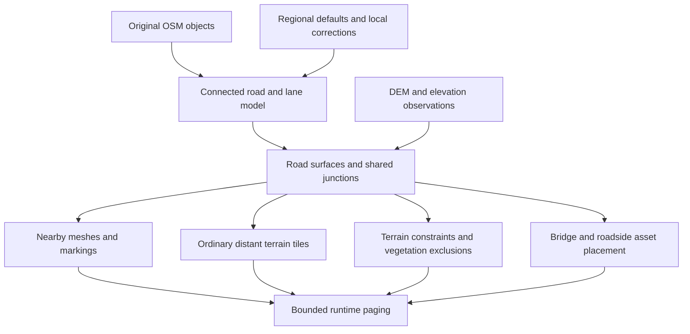

# Prestige Roads proposal

Current rendering direction (October 12, 2026): see the
[Prestige Roads rendering architecture](prestige-roads-rendering.md) and
[staged implementation plan](prestige-roads-rendering-plan.md). These supersede this document's
ground-surface rendering recommendations and keep osgEarth's regular gridded terrain.

Revised October 9, 2026 after reviewing GDC presentations and developer writeups.
Scope: realistic roads from ground level through globe scale in osgEarth.
Repository observations refer to revision `7b3676172`.

Build Prestige Roads around a persistent, connected road model compiled from original OSM data. Generate road
surfaces and junctions procedurally, dress them with reusable materials and swept component profiles, and derive
distant road coverage in ordinary osgEarth terrain tiles. Treat road elevation, terrain seams, and coordinated
LOD as core work. Use conventional textures, texture arrays or atlases, and existing tile paging. Virtual
texturing is outside this proposal; osm2streets is excluded as a dependency and implementation path.

The principal change from the earlier proposal is to make this a road surface compiler and renderer with a
bounded material system. A complete traffic simulator or generic street-rewriting framework is unnecessary.
Retain lane connectivity where known because it controls merges and markings; do not make perfect inferred
traffic movements a prerequisite for producing useful pavement.

The expected result is geographically grounded, visually plausible roads with explicit uncertainty where OSM
is incomplete. Survey accuracy, exact lane markings everywhere, and engineering-grade driving simulation require
additional data. Keep the model open to surveyed road surfaces, elevation observations, and local corrections.

**What the production research changes.** The recurring approach is curves and attributes feeding several related
products: pavement, terrain modifications, materials, and object placement. Authored assets provide detail within
that structure. The consequential failures are restrictive kits, terrain/road mismatch, decal cost, and procedural
changes invalidating too much work. This is a synthesis, not a claim that these games share one renderer.

The following review uses public slide decks, including speaker notes where supplied, and first-person technical
writeups. Page numbers are one-based PDF pages. The Frostbite entry is explicitly based on its session overview;
no claim here depends on having watched a members-only recording.

| Source and inspected material | Lesson from the source | Decision for Prestige Roads |
| --- | --- | --- |
| [Sunset Overdrive, David Santiago, GDC 2015](https://media.gdcvault.com/gdc2015/presentations/Santiago_David_Procedural_and_Automation.pdf#page=44), pp. 44–45 | A hex road kit restricted width, elevation, and curvature, required manual prop work, and made iteration slow. The replacement generated streets, intersections, sidewalks, and gutters from curves with spatially varying attributes. | Build arbitrary pavement surfaces. Use kits for cross-sections, trim, and repeated objects rather than a catalog of complete T/X intersections. |
| [Ghost Recon Wildlands terrain technology and tools, Guillaume Werlé and Benoit Martinez, GDC 2017](https://media.gdcvault.com/gdc2017/Presentations/WERLE_MARTINEZ_GRWterrainTechnologyTools.pdf#page=52), pp. 52–56, 62, 77, 82–85 | Screen-space road decals created prohibitive overdraw and did not affect displacement topology. Procedural roads also produced trajectories, terraforming, material masks, and bridges. Their VT solution required scheduling updates to cope with fast travel. | Reuse the coordinated outputs and the warning about coverage cost. Use offline preparation and bounded uploads; do not adopt their VT backend or their route-generating pathfinder for real OSM alignments. |
| [Procedurally Crafting Manhattan for Marvel's Spider-Man, David Santiago, GDC 2019](https://media.gdcvault.com/gdc2019/presentations/santiago_david_procedurally_crafting_manhattan.pdf#page=73), pp. 73, 82–86 | Small changes can cascade through UVs, props, and dependent content. The presentation emphasizes modular dependencies, manual authoring, tagging, and procedural validation. | Record reverse dependencies and persistent corrections. Rebuild affected junctions and pages without destroying unrelated hand-authored work. |
| [Procedural Tool Development for Marvel's Spider-Man 2, David Santiago, GDC 2024](https://media.gdcvault.com/gdc2024/Slides/GDC+slide+presentations/Santiago_David_ProceduralToolDev_with_notes.pdf#page=35), pp. 35, 39–44 | Profile sweeps preserve model materials/UVs; asset orientation and origins matter. Corner decals follow geometry-dependent rules. Acute/obtuse cases needed adjustment; unsuitable corners could omit decoration. | Define a strict profile-asset contract. Generate corner wear, seams, and tactile details after pavement geometry; let decorative failures omit detail without breaking the road. |
| [Delta Force: Performant High-Quality Terrain and Biome Technology for PC & Mobile, Lichuan Wang and Hang Jiao, GDC 2025](https://media.gdcvault.com/gdc2025/Slides/Jiao_Hang_Delta+Force+Performant.pdf#page=58), pp. 58–59, 102 | The low-spec path uses road meshes without VT. Road and terrain topology mismatch caused severe fighting; matching the terrain grid increased triangles, and distant simplification required another mitigation. | Test road/terrain LOD together immediately. Prefer disjoint pavement and terrain surfaces for high-quality paved roads. Their low-spec fallback is evidence of a workable representation, not proof of our quality or performance targets. |
| [From Battlegrounds to Fairways: Terrain Procedural Tools in Frostbite, Julien Keable, GDC 2023](https://www.gdcvault.com/play/1029086/From-Battlegrounds-to-Fairways-Terrain), session overview | Interdependent, non-destructive layers drive materials, topology, terrain integration, and scattering. | Make pavement coverage, grading, shoulder treatment, and vegetation exclusion products of the same road description. |
| [Fixing screen-space deferred decals, Bart Wronski, 2015](https://bartwronski.com/2015/03/12/fixing-screen-space-deferred-decals/) | Reconstructed-position derivatives can corrupt decal mip selection at depth discontinuities. Mesh UVs and applying decals in receiver shaders offer alternatives with their own costs. | Prefer stable surface coordinates and bounded material composition. Evaluate markings in motion at grazing angles, with filtering enabled. |
| [OpenSAGE road series, Daniel Sklenitzka, 2020: texturing](https://opensage.github.io/blog/roads-how-boring-part-4-rendering-straight-roads/) and [crossing selection](https://opensage.github.io/blog/roads-how-boring-part-6-choosing-a-crossing-type/) | Lengthwise repetition fixes stretched road textures. The reconstructed crossing atlas has no connected representation for five or more arms. This is an independent engine implementation, not an EA production postmortem. | Keep metric texture coordinates and a shared atlas for detail; generate junction geometry and paint independently of a fixed crossing atlas. |
| [BeamNG DecalRoad documentation](https://docs.beamng.com/modding/levels/level_classes/decalorad/), current reference | Captures/clips existing terrain or static-mesh triangles under strips, supplies longitudinal UVs, batches output, and regenerates after surface changes. Large depth biases can visibly float. | Keep conforming mesh decals as a useful terrain-preserving mode. Treat them as surface decoration, with explicit dependencies on the receiving mesh. |

These sources support component choices and expose failure modes; none establishes automatic, accurate OSM
reconstruction at planetary scale. Prestige must still supply source identity, robust junctions, elevation
constraints, and paging. Independent OSM converters such as [SUMO](https://sumo.dlr.de/docs/Networks/Import/OpenStreetMap.html)
can help compare selected cases, but are optional diagnostic tools. Their inferred connections are not ground truth.

**Choose a hybrid rendering approach.** Each technique has a useful role, but only a connected source model can
make all of them agree about road shape, markings, and elevation.

| Technique | Strength | Limitation | Recommended role |
| --- | --- | --- | --- |
| Fixed road and intersection model kits | Strong authored detail and efficient reuse | Arbitrary approach angles, lane counts, widths, and slopes create too many combinations | Profile assets, repeated components, and selected landmark structures |
| Tiled or trim-sheet textures | Cheap, consistent material detail | A single road texture stretches markings and cannot describe branching connectivity | Asphalt, concrete, shoulders, curbs, and bridge surfaces |
| Procedural road and junction meshes | Arbitrary geometry, multiple heights, silhouettes, and shadows | Robust junction construction and terrain fitting require substantial work | Nearby road surfaces and elevated structures |
| Rasterized road coverage | Low geometry cost across large areas | Resolution limits; a ground texture cannot represent stacked surfaces | Distant at-grade roads and terrain material masks |
| Mesh decals and receiver-shader overlays | Flexible local markings and repairs | Surface conformity, filtering, coverage cost, and material integration | Local detail with explicit surface ownership and bounded overlap |
| Virtual textures | Cache material work and support unique surface detail | Adds a residency and invalidation subsystem | Excluded from the proposed implementation |

Generate pavement, lane markings, and roadside objects as separate products. An arrow must retain its proportions
when a road widens; asphalt grain must retain its physical scale; an intersection must preserve its traffic islands.

**Use original OSM objects as the source of connectivity.** The demos load tiled `.pbf` features. OSM PBF and Mapbox
Vector Tiles are different schemas despite both using Protocol Buffers. MVT provides tile-relative geometry and
attributes, with encoder-dependent clipping and simplification. It can carry additional topology by agreement,
but the file format alone does not preserve original OSM node references or relation semantics.
[Mapbox format documentation](https://docs.mapbox.com/data/tilesets/guides/vector-tiles-standards/)

The current demo configuration does not establish exactly what survived the ReadyMap conversion. Audit sample
tiles against original OSM during the first milestone. Keep those tiles available for coarse display; use them as
a compiler input only if the audit demonstrates the required information, or their producer adds it explicitly.

Start with a regional `.osm.pbf` snapshot plus a DEM. Extract enough surrounding data to complete relevant ways
and all members of restriction/connectivity relations. Osmium's default `complete_ways` extraction does not make
relations complete. Its `smart` strategy can complete selected relation types; follow that with a missing-reference
check against the parent extract. A spatial buffer alone cannot guarantee relation completeness.
[Osmium extraction semantics](https://docs.osmcode.org/osmium/latest/osmium-extract.html)

Preserve the following in the ingestion contract:

| Information | Required treatment |
| --- | --- |
| Node IDs, ordered way-node references, way IDs, relation IDs and member roles | Preserve original direction and identity before simplification or splitting. Retain source version/timestamp for reproducibility. |
| `highway`, `oneway`, `junction`, access and conditional tags | Establish road class and directed travel permissions; retain unsupported conditions explicitly. |
| `lanes`, directional lane counts, `turn:lanes`, `change:lanes`, `width`, lane widths, `placement` | Construct variable cross-sections and distinguish OSM reference geometry from the physical center of pavement. |
| Restriction and connectivity relations, including via-way chains | Store allowed/prohibited movements and lane correspondence separately from surface geometry. |
| `bridge`, `tunnel`, `covered`, `layer`, `level`, `ele`, `incline`, clearance observations | Supply structural context and vertical constraints, with tag-specific meaning and units. |
| Surface, shoulders, sidewalks, cycleways, parking lanes, barriers, crossings, signals, mapped road areas | Refine appearance and boundaries where mapped; avoid duplicating separately mapped paths. |

Store raw tags alongside interpreted fields. Mark each interpreted value as explicit, inferred, or overridden,
with a reason and source references. A debug view should reveal uncertain widths, movements, and elevations.
For missing lane information, a plausible cross-section is acceptable; detailed directional paint requires higher
confidence. Unsupported conditional restrictions must not silently become unconditional permissions.

**Separate the road model from its render tiles.** Proposed data flow:

The canonical model needs five concepts: road sections with varying cross-sections; junction complexes with
approach ports; lane movements; vertical structures and constraints; and source provenance. A road section has
an alignment parameterized by distance, lane/shoulder boundaries, an elevation profile, and material references.
A junction owns one or more connected surface patches. Distinct structures can occupy the same map coordinates.

Maintain three separate relationships: physical road adjacency, legal travel movements, and pavement continuity.
A prohibited turn can exist over physically continuous asphalt. A projected crossing can exist without any road
connection. OSM restrictions describe legal movements, while connectivity relations describe lane correspondence.
[Restrictions](https://wiki.openstreetmap.org/wiki/Relation:restriction),
[lane connectivity](https://wiki.openstreetmap.org/wiki/Relation:connectivity)

Proposed compilation rules:

1. Split ways at shared connection nodes and relevant attribute changes, including junctions inside long ways.
   Match topology by source identity. Geometric proximity can flag questionable data, but cannot silently connect it.
2. Preserve divided carriageways, slip roads, and roundabout rings. Group nearby connected junction nodes only when
   their physical layout calls for one junction complex; retain the original internal graph and provenance.
3. Resolve explicit lane connectivity first, then applicable restrictions, turn-lane indications, placement, and
   conservative regional defaults. Check contradictions. Keep unresolved movements distinguishable from legal ones.
4. Generate cross-sections and physical surfaces from established physical connectivity. Unresolved legal or lane
   movements may suppress specific paint, but need not block otherwise valid pavement. Produce a readable
   diagnostic for contradictory constraints and permit local corrections without rewriting the OSM source.

Use an independent offline ingestion toolchain. Current libosmium upstream requires C++17, so adding its latest
headers directly to osgEarth would conflict with this repository's C++14 requirement. An external Osmium/OSM
adapter can emit lossless records for a C++14 compiler and runtime. Keep Rust, Python, or JVM evaluation tools
outside the runtime dependency graph.
[libosmium prerequisites](https://github.com/osmcode/libosmium#prerequisites)

Use a versioned binary tile contract for delivery, with debug exports to GeoJSON and optionally OpenDRIVE.
Prototype the schema before selecting its serialization library. OpenDRIVE is useful for exchanging road/lane
geometry, but need not become the globe's storage or paging model. Its junction elevation grid is a useful
reference for a shared junction surface with smooth approach transitions.
[ASAM junction elevation model](https://publications.pages.asam.net/standards/ASAM_OpenDRIVE/ASAM_OpenDRIVE_Specification/v1.8.1/specification/12_junctions/12_11_junction_elevation_grid.html)

For large-area preprocessing, stream OSM objects into an on-disk identity and dependency index. Compile bounded
regions with complete junction dependencies and shared boundary conditions, rather than loading the entire planet
graph into memory. Keep offline network partitions, runtime road pages, and terrain tiles independently sized.
Workers can build separate regions concurrently once ownership and shared vertical constraints are resolved.

**Construct junctions as surfaces with constrained boundaries.** Offset the approach cross-sections, identify
where the approaches must be trimmed, and build a junction boundary with bounded corner radii. Preserve holes for
islands and medians. Triangulate that domain with constraints and make its boundary vertices identical to those of
the connecting road strips. A convex hull of all approaches would incorrectly pave islands and open spaces.

Fit lane movement curves between compatible ports inside the drivable domain. These curves guide lane continuity,
placement, and eventual traffic, but do not all become painted lines. Marking generation needs its own rules for
stop lines, crossings, guide lines, and areas where paint should be omitted. Reject curves that cross an island,
leave the pavement, or imply an unsupported lane change.

Keep the initial implementation narrow: interpret mapped connectivity, widths, and cross-sections, construct
surface boundaries, and derive enough lane correspondence to render merges and warranted markings. Preserve
unsupported semantics as data. Full signal timing, vehicle behavior, and automatic repair of an entire routing
network are separate possible consumers of the result.

Handle these cases explicitly:

| Case | Proposed geometry and semantic treatment |
| --- | --- |
| Skewed T, X, and multi-arm junction | One coordinated patch per connected surface, arbitrary approach angles, constrained corner fillets |
| Short staggered junction or divided-road crossing | A junction complex with internal connectors; preserve medians and islands |
| Merge, diverge, or lane drop | Continuous alignment and variable-width lane strips, with taper and gore geometry; infer taper length only when absent and label it |
| Roundabout | Preserve ring circulation, center island, entry/exit geometry, and explicit lane information |
| Cul-de-sac or turning circle | Mapped outline when available; otherwise a constrained terminal template |
| Stacked interchange | Independent connected surfaces with crossing constraints; no junction created at geometric crossings |

Use conservative curve fitting bounded by the source geometry and surrounding constraints. Unrestricted smoothing
can move roads into buildings or close small islands. On a geometry failure, emit a simple valid surface and a
diagnostic rather than self-intersecting triangles or invented connectivity. Keep corrections keyed to source IDs
and spatial anchors, with conflict reporting when a later OSM snapshot changes the underlying objects.

**Solve elevation across connected roads.** OSM `layer` orders features locally where they cross; it is not a
height in meters. `level` has a different role inside structures. A negative layer does not by itself mean a tunnel.
Shared endpoints can legitimately connect ground roads and bridges whose layer tags differ, so partitioning every
road by layer would also be incorrect.
[OSM layer semantics](https://wiki.openstreetmap.org/wiki/Key:layer)

Fit longitudinal profiles and junction surfaces together using ground attachment elevations, measured elevations
where available, and smoothness/grade constraints. Enforce over-under clearance at crossings, allowing for deck
thickness. A signed maximum vehicle height is evidence about clearance, not an exact deck elevation. Missing
clearances and structural dimensions need configurable defaults and explicit uncertainty.

Measured or explicitly mapped constraints take precedence over heuristic defaults. If they conflict, preserve the
evidence and request a correction through the diagnostic workflow; do not move a known connection to satisfy a
guessed ramp grade. Replacing the map's elevation source must trigger a compatible road rebuild or select the
terrain-conforming mode, so cached road profiles cannot silently disagree with a new terrain dataset.

Use a fixed, versioned DEM sampling policy for compilation, independent of the terrain LOD currently displayed.
Normalize vertical datums before combining OSM elevations, DEM values, and osgEarth coordinates. Distinguish a
bare-earth DEM from a surface model that may already contain bridge decks or buildings. Prevent circular sampling
by solving against the base elevation source, then applying the resulting road constraints to terrain.

For at-grade roads, grade a roadbed and blend into cut/fill shoulders. For bridges, render decks, undersides, and
abutments independently; deform terrain only where their foundations or approaches require it. Add supports only
after checking roads, rail, and water beneath them. For tunnels, retain the underground connection, create portals
and appropriate terrain openings, and page interior geometry for nearby viewpoints. A single heightfield cannot
represent all stacked surfaces or a tunnel interior.

Offer terrain-conforming display as a lower-fidelity mode when terrain modification is disabled. Full ground-level
quality depends on coordinated terrain constraints, particularly at steep slopes and tunnel portals. If vertical
constraints are infeasible, expose the conflict instead of hiding it through draw order.

**Make the pavement/terrain join an explicit construction step.** Merely draping road vertices onto a DEM does
not make their triangles agree with the terrain between vertices. Independent simplification can make the road
alternate above and below the terrain. Delta Force's pp. 58–59 are a concrete production example of this problem.
The proposal therefore needs three deliberate modes:

| Mode | Construction | Intended use and tradeoff |
| --- | --- | --- |
| Pavement replaces terrain locally | Constrain terrain to the solved boundary, remove its interior, and insert the road/shoulder patch with identical boundary positions | Preferred nearby paved roads; supports crown, gutters, and grade. Requires coordinated constraints, boundary LOD, and residency |
| Road decorates existing terrain | Clip/capture the receiving terrain triangles and apply road coordinates/materials; regenerate with that terrain representation | Compatibility mode when terrain cannot be modified; inherits terrain roughness and triangle cost, and cannot supply independent crown or cut/fill |
| Road is a terrain material | Rasterize coverage and style inputs into ordinary terrain tiles | Dirt tracks and distant at-grade roads; no additional road silhouette or independent elevation |

Prototype the replacement mode through `TerrainConstraintLayer`. Require shared edge samples and matching edge
morph behavior at every participating terrain LOD; unconstrained terrain simplification must not move the seam.
This synchronization and the residency protocol are new integration work, not guarantees supplied by the current
constraint API. If they prove too intrusive, ship the conforming mode first with its quality limit documented.
Budget any small depth bias in that mode for residual rasterization error, not meters of geometric disagreement.

Publish road mesh, affected terrain mesh, and coverage changes as a coherent revision. Activate a terrain opening
only when its covering road is ready. Restore an intact terrain fallback before releasing that road. Unloading,
failed downloads, shadow cameras, and simultaneous ground/globe views must respect that invariant. Tunnel portals
use the same rule; bridge decks never remove the ground below merely because their footprints overlap it.

**Render by projected detail.** Suggested starting representations below are design choices to tune in the demo;
distance alone should not select them. Road width, curvature, silhouette error, camera angle, and pixel footprint
should control the transitions.

| View | Representation |
| --- | --- |
| Street and nearby oblique views | Road meshes with crown/crossfall, curbs, PBR materials, independent markings, and instanced roadside objects |
| Low flight and intermediate views | Simplified surface meshes where shape matters; terrain material coverage for at-grade pavement; fewer props and marking details |
| Regional views | Cached road coverage with filtered color/material contribution; simplified elevated geometry while its silhouette or separation is visible |
| Globe views | Filtered contribution from major roads only where resolvable; optional separate cartographic styling if the application wants exaggerated lines |

Do not bake a bridge onto terrain while its elevation is still visible. Transition by screen-space error with
hysteresis. Nearby mesh coverage must replace its corresponding terrain road contribution without double paint,
depth fighting, or sudden color changes. Preserve source-stable UV distance and dash phase across tile and LOD
boundaries; clip geometry only after those coordinates are determined.

Start the distant path with ordinary cached image/coverage tiles, mipmaps, and parent-tile fallback under existing
terrain paging. They have ordinary texture objects and geographic extents. No virtual address space, feedback
pass, sparse residency, or material page table is required. Rasterize from completed surface polygons, including
islands and shoulders, so mesh and image representations describe the same shapes.

Begin with filtered road albedo/coverage using `FeatureImageRTTLayer` as an experiment. Material IDs, roughness,
and shoulder masks can be additional conventional channels where useful, but integrating them into terrain
shading is new work; an RGB raster layer alone does not supply a complete road material. Avoid baking illumination.
Compute border texels from neighboring compiled surfaces and preserve mip coverage of thin features. Keep fine
paint as surface-local strokes or clipped meshes nearby, then integrate it into aggregate coverage at distance.

For a concrete prototype, a 256 by 256 m ground tile with a 512-square coverage texture gives 0.5 m/texel.
An RGBA8 tile costs 1 MiB, approximately 1.33 MiB with its full mip chain before compression. That is adequate
to describe many road footprints, but not ground-level paint or asphalt grain. Those come from vector/mesh detail
and shared materials. These are starting parameters to measure, not a proposed universal resolution.

Transition geometry and material ownership together. Keep the near road patch until replacement terrain is ready,
then morph the road toward the compatible terrain representation and transfer its coverage. Complementary masks
can blend appearance, but cannot fix an elevation mismatch. Elevated structures retain geometry while their
separation or silhouette is visible. Under memory pressure, remove decorative detail before degrading connectivity.

**Use reusable material detail with surface-local markings.** Give each road section physical longitudinal and
lateral coordinates, independent of node spacing and render-tile cuts. Use a metric local chart for junction
asphalt and smoothly varying orientation where directional material detail needs it. Preserve arc-length dash
phase along a section and across its render fragments; define intentional resets at junctions. Do not stretch
paint or aggregate size to fit a changed road width.

The initial material stack should stay small:

1. Repeated asphalt/concrete/gravel albedo, normal, and roughness textures, selected from a compact array or atlas.
2. Low-frequency color/roughness variation from stable section seeds, vertex attributes, and optional small masks.
3. Lane paint, crossings, arrows, and gore hatching driven by geometry and regional rules. Evaluate simple strokes
   in road coordinates; use dimensioned atlas shapes or small mesh decals for complex symbols. Mesh decals must
   follow the actual surface triangulation and morph, not float on an independently tessellated quad.
4. Sparse patches, seams, wear, and edge transitions with a bounded number of material contributions per fragment.

Blend paint and wear into albedo, normal, and roughness before lighting. Scope the first material implementation
to road receivers rather than requiring a new universal decal renderer. Batch complex markings into nearby spatial
chunks; do not create a scene-graph node or draw call for every dash. Use padded atlas mips, anisotropic filtering,
and derivative-aware stroke filtering. Fade unresolved detail into its average contribution to prevent shimmer.

Wronski's depth-reconstruction warning is relevant when selecting a decal technique, but it does not establish
that osgEarth's current shader has that bug: `Decals.glsl` uses interpolated receiver geometry positions. It is
already a useful starting point for receiver-side overlays. Extending its RGB-only blend to road materials needs
pre-lighting integration and explicit receiver/surface selection, especially under bridges. Broad, overlapping
screen-space volumes across an entire road network are not the proposed default.

**Generate a compact, controllable asset library.** The first art set should contain a few asphalt ages, concrete,
gravel, shoulder treatments, curb/gutter profiles, barriers, railings, bridge deck edges, and basic tunnel portals.
Use parameterized profiles and lengthwise trim sheets wherever geometry must follow the road. Instance rigid
objects such as posts, drains, signs, and lights with shared materials and bounded density.

A profile asset declares meter units, anchor, sweep axis, lateral/up axes, material slots, longitudinal texture
period, attachment edge, and allowed scale ranges. Use a stable transported frame along the 3D alignment so an
uphill bend does not twist the curb. Junction corners and changing-width transitions need generated joins, not
overlapping profile ends. Validate asset conventions at import, following the practical lesson from Spider-Man 2.
Houdini or another DCC can generate these assets offline; it is optional tooling, not a runtime requirement.

Corner decoration uses the solved curb boundary and crossing placement. A small rule set can place seams, ramps,
tactile surfaces, and patches, while handling acute angles and suppressing invalid decorative placements. Separate
geometric accessibility features from superficial wear: a missing crack decal is acceptable, a fabricated curb
ramp through a barrier is not. Preserve manual suppressions and replacements through recompilation.

Author paint as dimensioned vector/SDF shapes and procedural line rules. Keep country-specific colors, dash
patterns, crossing conventions, sign families, and driving side in regional style packs. Begin with one complete
pack, and use a second driving-side region to expose assumptions before expanding the art catalog.

Generated imagery is useful for asphalt variation, repaired patches, wear, and reference concepts. Validate
seamlessness, physical texture scale, and PBR channels; remove baked lighting. Keep regulatory symbols and lettering
deterministic and reviewable. Correlate wear with edges, wheel paths, and braking areas using stable seeds. Avoid
uniform random grime over the entire network. Optional licensed aerial imagery or surveyed boundaries can improve
selected locations; they must remain separate, attributable inputs.

At ground level, terrain fit, curb scale, consistent paint, and varied roughness deserve priority over dense props.
Where underlying aerial imagery contains displaced roads or baked shadows, use a coherent procedural ground
treatment or an explicit imagery-correction layer; drawing new asphalt alone will leave a visible duplicate.

**Fit the existing osgEarth architecture.** The repository already provides useful starting points:

- [Road demonstration](C:/Users/gwald/.codex/worktrees/c012/repo/tests/roads.earth) exercises textured line meshes,
  rasterized roads, flattened elevation, and terrain constraints. Use it as a baseline comparison.
- [Procedural RoadLayer](C:/Users/gwald/.codex/worktrees/c012/repo/src/osgEarthProcedural/RoadLayer.cpp:1734)
  builds a tile-local graph and clamps it to terrain. It currently skips negative layers, starts positive layers
  at zero offset, and uses layer values for draw order. Its node identity uses quantized XY coordinates. These
  choices are insufficient as the authoritative graph for the proposed connectivity and elevation requirements.
- [RoadNetwork](C:/Users/gwald/.codex/worktrees/c012/repo/src/osgEarthProcedural/RoadNetwork.cpp:16) joins feature
  endpoints, while its [identity representation](C:/Users/gwald/.codex/worktrees/c012/repo/src/osgEarthProcedural/RoadNetwork:27)
  quantizes XY. Introduce a source-ID-based model capable of internal-way junctions and lane movements.
- [BridgeLayer](C:/Users/gwald/.codex/worktrees/c012/repo/src/osgEarthProcedural/BridgeLayer.cpp:35) already clamps
  ground endpoints and interpolates connecting spans. Reuse mesh-generation ideas, but feed structures from the
  common vertical solution so adjoining roads and bridges agree.
- [RoadSurfaceLayer](C:/Users/gwald/.codex/worktrees/c012/repo/src/osgEarthProcedural/RoadSurfaceLayer:15)
  is a deprecated wrapper around `FeatureImageRTTLayer`. Start rasterization experiments with the underlying facility.
- [TerrainConstraintLayer](C:/Users/gwald/.codex/worktrees/c012/repo/src/osgEarth/TerrainConstraintLayer:16)
  can constrain mesh elevation and remove polygon interiors. Validate coordinated roadbeds and portal openings
  through this facility. Add and verify the road/terrain boundary and residency contract described above.
- [Current decal shader](C:/Users/gwald/.codex/worktrees/c012/repo/src/osgEarth/Decals.glsl:27) blends sampled RGB
  into fragment color. Full road material decals would need integration with normals/roughness and lighting;
  existing color decals alone do not supply that material behavior.
- [Prestige placement rules](C:/Users/gwald/.codex/worktrees/c012/repo/src/osgEarthPrestige/FeaturePlacement:70)
  and [asset caching](C:/Users/gwald/.codex/worktrees/c012/repo/src/osgEarthPrestige/AssetCatalog:37) provide patterns
  for exclusion inputs, immutable data, shared assets, and budget pressure. Adapt them where appropriate rather
  than tying road geometry to vegetation-specific classes.

Proposed components are a `RoadSource` adapter for compiled records, a geometry/elevation compiler independent of
render traversal, a Prestige road layer, and adapters exposing graded road footprints to terrain and vegetation.
These names describe new work, not existing APIs. Road surfaces can use batched OSG/Chonk geometry as appropriate;
repeated assets should share meshes and material arenas. Publish immutable worker-built results on the update
thread, bound uploads, support cancellation, and retain a valid coarse fallback on failure or memory pressure.
Compile large junction complexes coherently, then divide their render output into spatially bounded chunks for
culling. Neither one drawable for a whole city nor one drawable per marking gives useful cost control. Keep texture
reuse independent of geometry chunking, and cap active style packs along with geometry and tile residency.

Vegetation exclusion should follow actual ground occupation: pavement, shoulders, abutments, and support bases.
Elevated road decks need height-aware vegetation clearance; indiscriminately excluding their whole footprint
would remove valid vegetation underneath, while ignoring them could allow trees through the deck.

**Make tile independence an invariant.** Compile connected junctions and relevant approach spans before dividing
their output into render tiles. A fixed one-tile halo cannot cover every junction, ramp, or via-way restriction.
Expand dependencies until they are complete, or consume the already solved region model. Give each junction and
structure a stable owner and canonical boundary samples; render fragments can then be clipped or referenced
without independently solving the same boundary.

Use double precision and local metric working frames for geometry, with explicit distortion bounds. Avoid using
Web Mercator coordinates as uncorrected physical meters. Convert final vertices into local floating-point frames
anchored in double-precision geographic/ECEF coordinates. Test high latitude, antimeridian wrapping, and seams
between working frames, as well as ordinary tile edges.

Cache keys must include OSM revision, interpretation rules, corrections, elevation source/resolution/datum,
compiler version, and relevant style versions. Record reverse dependencies so an edited road invalidates its
junction, approaches, structures, terrain constraints, and neighboring output fragments. Publish consistent
revisions together, retaining the old coherent result while replacements load. Start with regional snapshots;
add replication-diff ingestion after dependency invalidation is demonstrated.

Keep edits as explicit overlays on source records: width/profile corrections, junction boundaries, elevation
anchors, and decorative suppressions. Attach them to stable IDs and spatial anchors, and report conflicts when
source objects change. Separate geometry dependencies from material and decoration dependencies: changing an
asphalt material should not retriangulate a city. A style change that alters curb width does require new geometry.
This limits the cascading rebuild problem emphasized in the Spider-Man production talks.

**Deliver through four gates.** Establish the terrain integration risk while defining the data contract, before
investing in a large importer or asset catalog. Each gate ends in an inspectable osgEarth scene and diagnostics.

| Gate | Concrete deliverable | Acceptance condition |
| --- | --- | --- |
| 1. Data contract and terrain spike | Small original OSM extract, demo-tile audit, graph diagnostics, and one curved sloping road/junction across a terrain-tile edge; compare replacement and conforming modes | Required references resolve or are reported. Width and identity survive ingestion. Demonstrate the terrain seam and fallback through LOD changes; select the supported initial mode |
| 2. Connected gray geometry | Streets, complex junctions, lane tapers, one stacked interchange, and a tunnel portal; source-ID-based corrections and uncertainty view | No false crossing connections; shared road/junction edges; valid triangles; feasible vertical ordering. A width/elevation correction rebuilds the affected neighborhood predictably |
| 3. Visual slice | One regional profile/material pack, bounded marking implementation, corner details, ordinary distant tiles, and a continuous ground-to-flight camera path | No visible seam, double road, stripe phase jump, projection leakage, or penetration. Rendering costs measured before adding a larger art catalog |
| 4. Streaming and scale | Regional coverage, coarse globe representation, budget controls, cancellation, coherent replacements, cache reuse, and localized rebuilds | Bounded memory across repeated traversals, measured frame costs, consistent results across tile layouts, and intact terrain fallback during delayed/failed road loads |

The reference corpus should include a suburban grid, a skewed urban junction, a roundabout with islands, a
motorway merge/diverge, a stacked interchange, a steep street, and a bridge-to-tunnel transition. Select examples
from at least two driving-side regions and include poorly tagged roads. Deliberately place tile boundaries through
junction centers and bridge approaches. Pair real extracts with small synthetic cases where the expected topology
is unambiguous.

For the first visual demonstrator, choose a compact area containing an awkward junction, a merge, and a bridge,
and use the same camera path for the current demo and proposed system. Add thin paint, acute curb corners, steep
crossfall, and a deliberately delayed tile load. Run ground-level grazing views, rapid flight, and two cameras
at different scales. These reveal failures that attractive overhead screenshots conceal.

Provisional acceptance targets, to calibrate against a named reference machine at Gate 1:

- Preserve every explicitly mapped movement and restriction in the reference corpus, or flag it as unresolved.
  Require zero accidental graph connections at grade-separated crossings.
- Keep shared generated boundaries within 1 cm in a common metric frame, with no visible cracking. This measures
  internal consistency and makes no claim about OSM's real-world positional accuracy.
- Use approximately one pixel of projected geometry error as an initial LOD threshold, with hysteresis and a
  coordinated road/terrain transition. Review grazing-angle motion, depth, and shadows in addition to still images.
- Aim for road-only p95 overhead below 1 ms on the main thread and 3 ms on the GPU at 1920 by 1080 on the selected
  desktop reference system. Begin with configurable caps of 512 MiB CPU residency and 512 MiB total GPU residency
  for roads. These are prototype budgets, not measured performance claims.
- Report compilation throughput, cold/warm tile readiness, main-thread stalls, GPU time, draw calls, triangles,
  peak CPU/GPU memory, and rebuild scope. Include dense urban geometry and several camera speeds; separate network
  latency from decoding, geometry, and upload costs.
- Measure terrain constraint/tessellation overhead and covered pixel cost separately from road shading. Cap
  material overlap, and inspect paint filtering and specular stability during motion. Verify that changing a
  decorative asset does not invalidate unrelated pavement or erase local corrections.

Compare raster, mesh, and hybrid paths using identical compiled road surfaces, data, materials, and camera paths
where those representations can express the same scene. Report quality differences alongside cost, particularly
for silhouettes and stacked roads. Separately compare output correctness with the existing demo. Any performance
implementation should follow the repository rule:
transient Google Benchmarks with before/after numbers and behavior validation, plus frame-level GPU measurements.
Windows validation uses `configure.bat`, `build.bat`, then `osgearth_shell.bat` before test or benchmark commands.

Retain OSM attribution and dataset licensing metadata throughout compilation and export. OSM data uses ODbL;
the distribution plan needs to account for the distinction between a derived database and rendered outputs.
Track licenses for art independently from code and map data.
[OSM copyright and license](https://www.openstreetmap.org/copyright)

The first implementation investment should be a small source-preserving road compiler paired with the terrain
integration spike. Once an awkward intersection, a merge, and an elevated crossing remain coherent during terrain
LOD and page changes, build the reusable material/profile library and ordinary tiled distant representation on
that foundation.

A first [Alewife geometry experiment](../../tools/experiments/prestige_roads/README.md) now implements a bounded
source-preserving compiler and runnable osgEarth scenes. It retains node-based topology, unions pavement while
preserving islands, and renders separate bridge decks using conventional glTF and textures. Its real OSM layout
uses controlled synthetic heights. The initial results prioritize width/tag diagnostics, explicit vertical
constraints, and a single surface definition shared by pavement and paint. Terrain LOD/residency correctness,
finished intersections/materials, distant representation, and production performance remain unvalidated; the
experiment report records the observed shortcomings and next steps.

The second experiment pass replaces the nearest-profile height output with a harmonic fit on the pavement mesh,
with hard bridge-cap and underpass constraints. It adds simple curbs, barriers, abutments, and seven source-tagged
crosswalks. Clearance is checked over overlapping rendered triangles, and the generated road/terrain boundary
vertices are compared after float conversion. Settled ground-level views at two terrain-detail settings look
coherent; continuous paging and the distant representation still need dedicated validation. Paint subdivision
now dominates the triangle budget, strengthening the case for comparing ordinary material masks in the next pass.

The third pass adds an explicit layout stage for one seven-approach junction before triangulation. Four OSM
mandatory-through restrictions constrain seven directed lane connectors, including an inferred two-plus-one lane
addition into a three-lane exit. Lane ribbons drive the pavement interior and guidance markings; crossings become
conflict records without extra graph connectivity. Source evidence, inferred lateral assignments, and unsupported
cases are exported separately in the experiment report. This establishes one bounded intersection compiler case;
two-way turns, lane drops, conditional restrictions, junction clusters, and vehicle swept paths remain future work.

The fourth pass extends the explicit layout stage to four junctions and nineteen lane connections. Directional
signal nodes identify two controlled confluences; their lane streams can share exit lanes without being mistaken
for simultaneous lane drops. Eleven inferred stop bars retain their signal-node evidence and placement offsets.
Bar exclusions respect actual crosswalk passages, and road-edge paint follows the final pavement perimeter rather
than overlapping source-way outlines. A source-corridor fallback avoids cutting lane paths across preserved islands.
The report distinguishes road restrictions, control evidence, and inferred lane/marking geometry; phases, priority,
uncontrolled acceleration merges, and surveyed stop-line shapes remain unresolved.

The fifth pass expands the source context westward to establish the actual three-to-two lane-count change beyond
the highway bridge. A separate longitudinal solver builds an inferred 180 m taper with continuing and merging
lane paths. Automatic junction discovery replaces the four-case setup table and resolves six junctions with
31 lane connections, including two right-hand-traffic T-junctions with opposing traffic and turns. Mouth geometry
comes from widths, signal locations, and available approach length; ownership conflicts and unsupported topology
produce explicit diagnostics. Source controls remain separate from marking assumptions. The expanded crop has
eleven inferred signal stop bars and eleven rendered tagged crosswalks. Export, lane-direction, restriction,
support-envelope, and deliberate invalid-input checks pass; both highway clearances remain above the experimental
minimum. This is bounded coverage, not a complete lane solver: turn pockets, conditional restrictions, divided-road
transitions, junction clusters, and swept vehicle paths remain open. Ordinary texture masks and LOD remain the next
rendering investigation; no performance improvement is claimed from this geometry pass.

The sixth pass tests ordinary urban junctions in a separate downtown Manhattan/Tribeca scene. Automatic
discovery resolves ten three-way and eight four-way junctions with 73 lane connections, including mixed
one-way/two-way approaches and a mapped left-turn lane at Varick/Franklin. That left lane exits while the
other two continue; it is not collapsed into a merge. Straight/arc/straight urban turns are checked against
curb envelopes, and source arrows remain separate from inferred lane assignment and legal restrictions.
The scene renders 56 marked crossings and 28 inferred stop bars, retaining the ambiguity of shared-node
signals and reserving unpainted crossing passages too. Seven junction candidates remain explicitly unresolved.
The prior Alewife geometry remains byte-identical. See the [Manhattan experiment report](../../tools/experiments/prestige_roads/MANHATTAN.md).

This pass also exposes the next connectivity boundary: a lane can be introduced on a block without a direct
incoming junction connector. The export now reports those lanes explicitly. Longitudinal turn-pocket entry,
inter-junction lane changes, larger junction clusters, and vehicle swept paths remain distinct work items.

The seventh pass revisits those seven Manhattan candidates. A wider crop fixes four incomplete approaches;
a bounded single-lane fork and a five-arm, single-node junction add explicit connectivity. The unexplained
West Broadway/Franklin two-to-one count change now has a provisional edge-lane turn hypothesis, with no
invented arrow or legal exclusivity. All seven have geometry, but that one allocation still needs source
confirmation. The expanded scene emits 28 layouts and 116 lane connections, 75 marked crossings, and 43
inferred stop bars. The prior eighteen urban lane paths remain identical. Four newly included boundary or
connectivity-relation cases remain diagnosed; this does not establish a general multi-node cluster solver.

The eighth pass stress-tests retained extracts from Boston, Pittsburgh, London, Paris, and Sion. It produces
105 layouts and 480 connections across those scenes, including two pairs of close T-junctions resolved as
compound layouts with source-graph reachability. It adds handed lane geometry, narrow shared lanes, vehicle
restriction scope, and via-node lane-connectivity relations; the latter also resolves another Manhattan case.
London's dotted crossing boundaries and Sion's yellow markings are represented with explicit source/inference
provenance. Bus/PSV-qualified lanes are now diagnosed instead of silently assigned to ordinary car traffic.
Bridge approach collars, shared cross-sections, and a mesh curvature penalty fix new surface failures;
Pittsburgh's localized maximum falls from 24.12 percent to 7.97 percent without relaxing the grade guard. These results strengthen the case for a locale-aware semantic
stage and explicit compound ownership before mesh generation. See the [city stress-test report](../../tools/experiments/prestige_roads/CITIES.md)
for provenance, checks, run instructions, and remaining limitations; no production LOD or performance claim is made.

The ninth pass separates physical lane sections from private-car eligibility. Source-supported bus/PSV
lanes and bus contraflow retain their width and physical numbering, while car paths use eligible lanes.
Legacy access uncertainty remains an explicit inference; designated bus use does not become a claimed
legal car ban. The five-city output now has 121 layouts, 540 car connections, 424 marked crossings,
171 inferred stop bars, and 11 inferred BUS words. Seventeen layouts are added, and one London allocation
is withdrawn because bus contraflow lacks directional counts. All 104 surviving first-sweep city path
sets and all 29 Manhattan path sets remain identical. Bus intersection movements and signal phases are
still unresolved. See the [lane-role report](../../tools/experiments/prestige_roads/LANE_ROLES.md).

A final control correction makes fallback stop bars use those physical travel directions too. It recovers
three contraflow bars in London/Paris and withholds three older Pittsburgh bars whose combined signal and
crossing tags do not establish a separate stop position. The total stays at 171. Existing lane paths and
all surviving bar coordinates are unchanged; resolving combined crossing/control positions remains open.

The tenth pass introduces retained ReadyMap elevation in Pittsburgh and Sion, with explicit EGM96-to-ellipsoid
conversion. Sion compares the same fitted road mesh against untouched terrain and a sparse grading raster derived
from the actual pavement triangles. Approximately 13.7% of the pavement would be buried on untouched terrain;
the overlay restores the demonstrated junction without TerrainConstraints, with less than 1.8 m cut/fill in
this patch. Meshes and terrain should consume one height solution. The new Prestige FlatteningLayer currently
infers its own profiles and ignores feature Z, so this experiment uses a road-owned GDAL elevation overlay rather
than stacking independent flatteners. Pittsburgh's fit still fails the unchanged grade guard, and endpoint-only
DEM bridge inference fails clearance in both cities. These results make constrained vertical alignment and
bridge support/clearance solving the next compiler step. See the [real-terrain report](../../tools/experiments/prestige_roads/REAL_TERRAIN.md)
for matched-camera images, source provenance, checks, and executable comparisons.

The eleventh pass composes bounded Boston and Pittsburgh districts with ReadyMap elevation, connected
road profiles, road-owned grading, native map-clamped buildings, and Prestige vegetation. Both city
pavement fits pass the unchanged slope and footprint checks. The scenes contain 362 unique junction
layouts, 1,664 lane connections, 3,158 building features, and 3,791 mapped tree positions. Source evidence
and height, species, and grading assumptions remain separate. This demonstrates the shared-elevation
contract: solve the roads, derive grading from that surface, and let all placement consumers query the
composed map. It does not require TerrainConstraints or another independent flattening solution.

Larger footprints exposed and corrected disconnected-ground welding, bridge-only nodes incorrectly
pinning terrain, cross-road height influence, and repeated precision snapping during export. Boston's
exported ground vertices clear the grading raster; Pittsburgh retains a localized raster-resolution
failure at 62 distinct vertices. Bridge-ground screens flag 23 Boston and 40 Pittsburgh overlap pairs,
and stacked bridge clearance is still unchecked. The next correctness work should resolve vertical
ownership and constrain the final sampled grading surface, with resolution refinement or explicit
structures where one height field cannot represent the intended geometry. See the
[combined city-terrain report](../../tools/experiments/prestige_roads/CITY_TERRAIN.md) for native views,
measurements, reproducible launch commands, and limitations.
