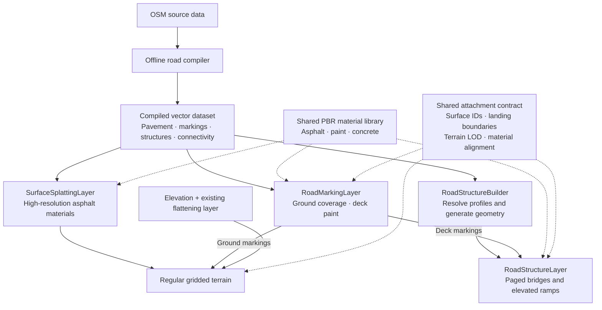

# Prestige Roads rendering architecture

October 12, 2026. Status: minimal ownership contract and first asphalt-on-terrain prototype implemented.
Terrain paint coverage is now the provisional ground-marking backend after the
[first decal/mask comparison](../../tools/experiments/prestige_roads/MARKINGS.md).
The dedicated marking abstraction and structure renderer remain proposed. See the
[prototype report](../../tools/experiments/prestige_roads/SURFACE_SPLATTING.md) for the current scope and checks.

Use splatted asphalt, terrain paint coverage for ground markings, and separate geometry for bridges and elevated ramps.
Retain decals as an option when exact surface attachment is demonstrated. Keep deck markings bound to
their separate structure receiver.
Share material definitions, surface ownership, and attachment rules across those rendering paths.
The existing elevation and flattening stack supplies osgEarth's regular gridded terrain.

This document supersedes the ground-surface rendering recommendations in the
[original proposal](prestige-roads-proposal.md). The [implementation plan](prestige-roads-rendering-plan.md)
defines the staged experiments and acceptance gates. The existing offline compiler remains the source of
road shapes and connectivity. Virtual texturing, osm2streets, and custom replacement terrain meshes are excluded.

## Architecture

Solid arrows represent data and rendering paths; dashed arrows represent shared services and contracts.
SurfaceSplattingLayer has a prototype implementation; other component names remain proposed interfaces.

## Asphalt and material splatting

Create a new Prestige `SurfaceSplattingLayer` with a road-specific coverage provider. The road polygons
determine where asphalt belongs; reusable high-resolution materials determine its appearance.

* Generate coverage/control tiles from the compiled polygons, preserving holes, islands, and boundaries.
* Sample shared PBR albedo, normal, and roughness maps at a declared physical scale.
* Separate aggregate detail, larger surface variation, and optional repair materials.
* Use double-precision geographic placement and stable local metric shader coordinates. Material phase
  must remain consistent across pages and between terrain and bridge decks.
* Add optional stochastic sampling for irregular asphalt textures after establishing a measured baseline.
  Do not randomize marking shapes, spacing, or placement.
* Blend material properties before lighting where they share a material evaluation path. Height-aware
  material blending is a shading option; it does not alter the terrain elevation grid.

Use ordinary osgEarth paging and conventional compressed material textures. BC7 color/packed maps and
BC5 normals are candidates where supported, with a validated platform fallback. Do not require a unique
high-resolution color texture for every square meter of road. Avoid making a new vendor-specific bindless
requirement part of this layer's baseline.

The old procedural implementation already has PBR, distance-field coverage, and optional anti-tiling.
The intended improvements are explicit material ownership, controlled sampling cost, stable coordinates,
predictable LOD behavior, and shared terrain/deck shading. Relevant existing implementations are
[TextureSplattingLayer](../../src/osgEarthProcedural/TextureSplattingLayer.cpp),
[FeatureSplattingLayer](../../src/osgEarthProcedural/FeatureSplattingLayer.cpp), and
[MaterialTexturePreparation](../../src/osgEarth/MaterialTexturePreparation).

## Markings and decals

Keep markings as a separate rendering responsibility. High-resolution asphalt textures cannot recover
thin paint geometry lost in a coarse mask. Preserve the compiler's actual marking polygons; texture
atlases may supply paint detail but must not substitute approximate arrow kits for the generated shapes.

| Backend | Useful properties | Risks to measure |
| --- | --- | --- |
| Terrain-conforming mesh decals | Preserve vector shapes; reusable paint textures; explicit surface attachment | Grid conformity, terrain morphing, depth bias, triangle count, draw calls |
| Coverage masks in the receiver shader | Follow the terrain or deck directly; no separate paint depth surface | Required texel density, residency, compression and filtering losses |
| Screen-space projected decals | Can project onto changing geometry without rebuilding decal meshes | Receiver isolation, depth-edge derivatives, overdraw, rendering infrastructure |

Current ground prototype: coverage masks at near and far ranges. The first GPU depth-clamped mesh-decal
comparison failed close attachment; exact grid-attached decals remain an alternative, not a demonstrated
capability. The marking report records the provisional decision and remaining tests. Screen-space projection
remains an optional challenger if the primary candidates leave a specific unresolved problem.

Batch decals by page and material rather than by dash. Evaluate the paint material with compatible road
lighting, normal, and roughness conventions. A forward mesh-decal implementation does not inherently
modify the terrain's material buffer; validate its result against paint evaluated in the receiver shader.

Ground decals must follow the rendered regular-grid triangles and their morphing, not just independently
sampled DEM heights. A proposed terrain attachment interface would expose tile identity, grid geometry,
elevation inputs, morph state, and revision. Splitting marking geometry along terrain triangles and using
the same interpolation is one implementation candidate. This creates marking geometry without replacing
the terrain mesh. This interface is new integration work, not an existing capability we can assume.

Bridge paint attaches to its owning deck. Upper-ramp paint must not reach a road below. The existing
[GPU clamping technique](../../src/osgEarth/ClampingTechnique) is a comparison baseline; its documented
depth-capture resolution and jitter limitations require checking at street-level and grazing views.

## Structures and ground connections

`RoadStructureBuilder` consumes the separate structure vectors and topology. Resolve a connected
structure's profile before splitting its geometry into render pages. Generate decks, undersides, bridge
edges, and eventually supports and barriers. `RoadStructureLayer` pages the generated geometry.

Layer and level tags express source relationships, not measured elevations. A vertical preparation stage
must obtain or infer heights, grades, and clearance constraints before producing plausible 3D structures.
Retain observations and assumptions separately. The renderer must not guess new heights independently
for each loaded tile. Unknown heights can remain unknown in the vector product.

| Shared connection field | Purpose |
| --- | --- |
| Surface and connection IDs | Identify physical pavement adjacency independently of legal turn movements |
| Boundary cross-section and width | Make ground pavement and landing meet in the same place |
| Profile status, vertical datum, terrain revision | Identify resolved placement and its dependencies |
| Tangent and approach grade | Avoid abrupt or twisted transitions |
| Material coordinates and marking continuity | Keep texture scale, phase, and paint aligned |
| Geometry/material ownership | Prevent duplicate pavement and paint at the handoff |

A landing has a short attachment region whose terrain-facing edge follows the rendered grid while the
span follows its resolved profile. ElevationPool sampling alone cannot guarantee a seamless result during
terrain LOD changes. An abutment can conceal underside cracks but cannot repair a top-surface mismatch.
Avoid accepting an excessive depth offset as a substitute for correct attachment.

Curbs, barriers, and structural silhouettes require geometry; splatting cannot create their physical height.
Their detailed generation follows the surface, marking, and landing experiments.

## Paging and cost

Keep a small shared material library resident. Page road data, decal geometry, and coverage. Empty pages
should allocate no road content. Keep parent content available until replacements are ready, include
parents and uploads in the residency budget, and cancel stale jobs after data or terrain changes.
Give each marking one active representation during a handoff; avoid drawing both at full opacity.

Prototype control textures use ordinary terrain-tile bindings. Independent higher-resolution material
paging is not assumed to be free: increasing terrain tile density or per-tile texture resolution has costs
that must be measured. Generate coverage from vectors with sufficient context and consistent borders.
Do not compress fine marking masks until their shape and coverage tests pass.

Allocation examples, not measured performance:

* A 2048-square material with three BC7/BC5 maps and full mipmaps uses approximately 16 MiB.
* Sixty-four 512-square uncompressed two-channel marking masks with mipmaps use approximately 43 MiB,
  before borders and staging buffers.

Splatting avoids unique high-resolution color imagery over the whole city, but does not eliminate coverage
memory or shader cost. Measure GPU time, residency, draw calls, triangles, page-build time, and cold-load
behavior before asserting an improvement over the raster or vector-geometry baseline.

## Grading integration: separate component, initial integration present

The related task is **Rebuild FlatteningLayer**, inspected October 12, 2026. Its generic Prestige elevation
layer is now integrated here as `GradingLayer`, registered as `prestige:grading`, independently of the road
renderer. The initial Boston level-pad check is now superseded by centerline-driven road grading in Boston,
NYC, and London. Each grading feature pairs complete centerlines with compiled pavement polygons; profile
elevations come from the preceding ReadyMap layer. Sparse native LOD 16 tiles provide the graded elevation
for finer regular terrain. See [the road grading report](../../tools/experiments/prestige_roads/ROAD_GRADING.md).

Its current implementation accepts terrain-derived line corridors, level polygon/point pads, and metric
width/buffer expressions, plus the opt-in paired road-footprint policy. It ignores feature Z. It requires complete
unclipped alignments for consistent
profiles, and is designed for roads as well as future buildings, airport areas, and other GIS features.

The bounded junction-pad adapter is a first integration check. Do not generalize it by feeding a city's
merged asphalt polygon into the level-pad policy: that would erase longitudinal grades. The new road policy
uses compiler-owned alignments and authoritative footprints. Junctions now share one plane fitted from their
centerline terrain samples, with gradual transitions applied only to explicitly connected profiles. This
corrects the NYC crease from the former distance blend; the before/after comparison remains a regression case.
The resulting grades remain inferred from the elevation source and are not an engineering-grade design.

Agree on these rules now:

* The compiler owns road selection, geometry, surface identity, topology, widths, and provenance.
  The renderer and flattening adapter consume those same decisions.
* Bypass independent width inference for compiled roads. The other task's optional OSM width filter
  remains useful for raw OSM, but must not reinterpret widths already resolved by this compiler.
* Separate grading-eligible ground roads from bridges, elevated ramps, tunnels, and unresolved layered
  roads. Model landings may provide explicit local ground attachment regions later.
* Preserve full source-alignment context before render-tile clipping. Share feature revision and changed
  extents so terrain and road consumers can invalidate corresponding outputs.
* The flattening layer samples preceding source elevation layers; visual placement samples the resulting
  final elevation stack. Avoid a circular dependency between road appearance and terrain generation.
* The current terrain-derived policy ignores Z. Honoring solved profiles later requires an explicit new
  policy and datum contract, not merely putting Z coordinates into a GeoJSON file.
* Keep the generic elevation interface open to building/airport pads and future rivers or inland water.
  A sloping river must not automatically receive the constant-height polygon-pad policy.

The three-city prototype checks shared pavement coverage, sparse output, elevation-stack order, native tile
boundaries, structure exclusion, and finer-LOD reuse. Building and inland-water grading remain separate future
policies; their geometry must not silently enter the road-profile mode.

## Research grounding

These references motivate individual choices; this architecture is a proposal for osgEarth, not a claim
that all AAA games use the same renderer.

* [Unity: procedural stochastic texturing](https://unity.com/blog/engine-platform/procedural-stochastic-texturing-in-unity)
  explains reducing repetition for irregular textures and the limitations for precise geometric patterns.
* [Terrain in Battlefield 3, GDC 2012](https://media.contentapi.ea.com/content/dam/eacom/frostbite/files/gdc12-terrain-in-battlefield3.pdf)
  describes hierarchical payloads, splatting masks, and bounded residency. Its virtual-texturing backend
  is outside this proposal.
* [Bart Wronski: fixing screen-space deferred decals](https://bartwronski.com/2015/03/12/fixing-screen-space-deferred-decals/)
  explains filtering failures at depth discontinuities and alternatives with explicit surface coordinates.
* [Epic: mesh decals](https://dev.epicgames.com/documentation/en-us/unreal-engine/using-mesh-decals-in-unreal-engine)
  provides a reference for surface-following decal geometry and depth-offset tradeoffs. Unreal's rendering
  integration is not assumed to exist in osgEarth.
