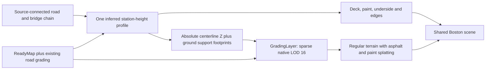

# Shared bridge and road grading profile

October 12, 2026. The Congress Street bridge now has a separate prototype in which the deck and
its connected ground approaches consume one compiler-owned height profile. The original bridge
experiment remains available for comparison. No custom terrain mesh is involved.

## Data flow



The source chain contains the three Congress Street bridge ways and one ground edge on each end.
Connections use shared source node identity. The complete alignment is 199.46 meters; the bridge
occupies stations 13.54 through 172.24 meters. Its short approaches are included in the same solve.
Original centerline bends are retained, with additional samples every two meters.

The solver uses existing ReadyMap plus road grading as its observation. It pins the outer approach
endpoints, penalizes abrupt grade changes, and applies an explicitly inferred 8.5% grade cap. The
interior span is at least 1.25 meters above that DEM observation. These are rendering assumptions:
the coarse DEM includes the existing crossing, so this is **not a measured water clearance or an
engineering bridge profile**. A lower 6% cap was infeasible for the selected endpoint and obstacle
constraints; that failure was not silently accepted.

The same complete centerline XYZ appears in `solved-profile.geojson` and every paired grading feature.
The deck interpolates this profile and partitions its top triangles into asphalt and paint. Materials,
metric texture scale and phase are shared with the ground renderer. Geometry includes an underside
and fascia, tapering near the landings; this remains a simple slab, not a bridge-family generator.

## Regular-grid terrain integration

The new `profile_elevation=absolute` policy is opt-in. Existing terrain-derived corridors, junction
planes and level pads retain their behavior. In absolute mode, GradingLayer consumes source centerline
Z, converts its declared vertical datum to ellipsoid meters, and performs no terrain resampling or
profile smoothing. Polygon Z is ignored. Each feature supplies one continuous line and paired masks;
ambiguous multi-line inputs, invalid heights and junction refitting are rejected.

The overlay uses the compiled ground approach footprints plus small, explicitly inferred support pads
at the two landings. Each pad extends eight meters into the span, six meters onto its approach, and
ten meters to each side; the shoulder is five meters. The central span does not grade the terrain
beneath it. These dimensions are prototype parameters, not mapped abutments or water-bank geometry.
Ten-meter endpoint transitions fade the solved approaches into the preceding road grading.

Terrain beneath the deck overlap has a separately attributed -0.03-meter receiver offset. Ground
approaches use zero offset, and their shoulders blend the two policies. The solved profile and deck
vertices are unchanged. This small terrain recess removes the coplanar flicker observed during the
first camera tour; it is not applied to the whole road network.

Only global-geodetic elevation LOD 16 is generated, with 257-square sparse grids. Finer terrain
resamples it, and no-data falls through to the original elevation stack. Asphalt and marking coverage
continue to use separate R8 material passes starting at LOD 15. Elevated paint remains attached to
the deck triangles, never to the terrain below the span.

## Checks and retained evidence

The worktree builds using `build.bat`, with public ABI version 193. Transient validation code remains
outside the repository. The grading harness passes **10,158 assertions in 24 cases**, covering the
existing terrain modes plus explicit profile heights, datum conversion, reversal, endpoint fading,
shared edges, duplicate source IDs with distinct elevations, bad inputs and finer-LOD fallback.

The independent native-grid audit inspects 198,147 samples. All 577 fully controlled interior samples
match the shared profile and receiver-offset blend within one micrometer. No valid overlay sample
lies beyond the declared influence. All 514 repeated shared-edge samples agree exactly. Composed
elevations beneath the central span change by at most 0.042 millimeters from resampling precision.

The final glTF contains 23,794 triangles and no degenerate triangles. Direct buffer inspection confirms:

* Pavement symmetric difference is 0.001104 square meters; discrepancies remain inside a 0.15 mm
  boundary tolerance for float render vertices.
* Yellow paint symmetric difference is 0.001912 square meters, with the same boundary tolerance.
  This source span has no white paint polygons.
* Paint-to-deck height error is below 0.003 mm, unit normals pass, and material texture phase agrees.
* Original source and material hashes are unchanged. Extracting the reusable deck exporter also
  reproduced the old prototype's glTF and binary buffers byte for byte.

Both landings were sampled against actual rendered terrain at LOD 18 and 20, with the hit tile's
LOD verified: all 256 boundary probes have positive separation, from 5.36 to 20.12 millimeters.
Numerical results are in `render-validation.json`. This small deck-to-terrain separation comes from
the declared terrain recess and grid interpolation, not missing grading.

Two GL4 camera tours move from 30 meters to 900 meters and back, with terrain morphing enabled and
maximum LOD 22. Each retains 23 framebuffer captures. Loaded close views no longer show the former
coplanar bands or large landing opening. The first narrow support footprint produced about half a
meter of mismatch at the eastern LOD-18 landing; the final support pads corrected that failure.

The captures also retain two limitations: terrain coverage temporarily softens while finer pages load,
and model/terrain cold-load visibility is not yet coordinated. The tiny paint breaks at the deck ends
are already in the source polygons. Do not treat these tests as an exhaustive runtime attachment or
elevation-revision guarantee. The central water surface and bridge families are not modeled.

## Inspect and reproduce

```powershell
python tools/experiments/prestige_roads/bridge_grading.py build
./tools/experiments/prestige_roads/view_bridge_grading.ps1 -View overview -GL4
./tools/experiments/prestige_roads/view_bridge_grading.ps1 -View west-landing -GL4
./tools/experiments/prestige_roads/view_bridge_grading.ps1 -View east-landing -GL4
```

The build consumes the retained terrain sample snapshot and validates its source/query identities.
`prepare` regenerates the query and base scene; a new runtime sample is required if those inputs change.
The launcher initializes `osgearth_shell.bat` and rejects incomplete output. The package depends on the
retained Boston fixtures and original shared materials; it is not a standalone distribution.

Evidence and scenes: [`output/bridge-grading-boston`](output/bridge-grading-boston/).
Useful close captures: [western landing](output/bridge-grading-boston/tour-final-west/frame-21.png),
[eastern landing](output/bridge-grading-boston/tour-final-east/frame-21.png).
The earlier failing tour is retained in `tour-west` for comparison.

NYC's curved ramps and a London crossing remain the next separate adapters. The NYC candidate connects
to another elevated road, so its upper endpoint must inherit that receiver's profile rather than grade
the ground below. Westminster's road and parallel cycleway share source nodes, which requires explicit
receiver selection. Neither case is presented as solved by this Boston prototype. Runtime revision
coordination and general elevated junctions remain open in the [staged plan](../../../docs/design/prestige-roads-rendering-plan.md).
