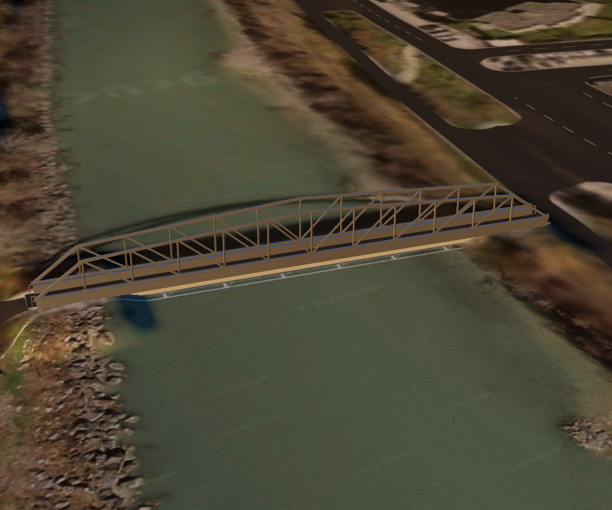
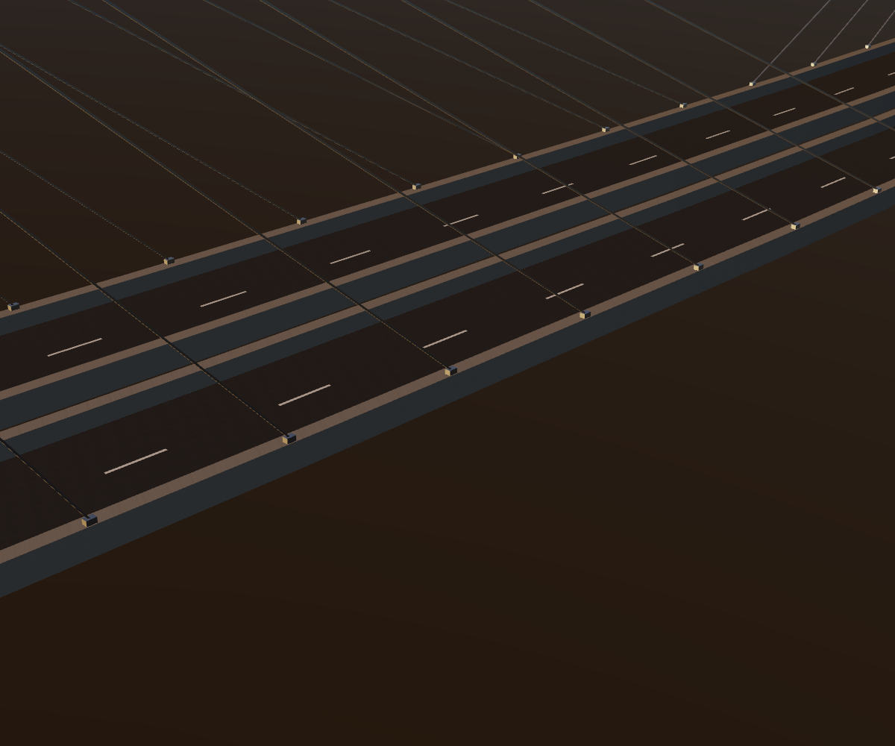

# Prestige Roads checkpoint — 13 October 2026

This checkpoint preserves the compiler, Prestige surface splatting and grading layers, core integration
fixes, source OSM snapshots, retained elevation samples, design documents, and launch scripts. It includes
the approved fat-merge policy, procedural bridge families, smooth cable-span profiles, Parker/Pratt trusses,
and family-owned edge girders with seated cable anchorages.

The latest Sion reference has 49 deck assemblies and 1,050 procedural member segments. Its truss and cable
bridges replace generic railings only within successful structural edge treatments. All 186 deck material,
underside and fascia meshes remain bit-identical to the preceding delivery, as do unrelated railings,
grading profiles and fat-merge vectors. The original Boston deck regeneration is also byte-identical.

[Retained Sion validation evidence](checkpoints/2026-10-13-sion/bridge-edge-validation.json) and the
[bridge-family report](BRIDGE_FAMILIES.md) describe the checked state. The retained manifests are evidence
snapshots: their runtime paths refer to generated files that are not part of this Git checkpoint.

Generated meshes, vector packages, raster pyramids, caches, build products, local viewer layout files,
and transient validation programs remain outside Git. The experiment's existing `output/` ignore rule
is unchanged. Existing demos remain on the local worktree; a fresh clone needs dataset generation and
normal project configuration/build before launching them. Some integration demos also reference local
Prestige building assets, as documented in [README](README.md).

The grading demos currently use native LOD 16 tiles with 257 by 257 elevation samples. Higher terrain
levels resample this native grading resolution; no-data samples fall through to preceding elevation.
Sion uses indexed FlatGeobuf for runtime queries and retains GeoJSON as inspectable generated output.

Validation for this checkpoint carries forward the completed targeted tests and visual inspection;
no new full native test-suite run is claimed. Bridge dimensions and heights remain explicitly inferred.

