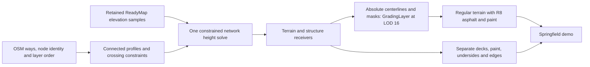

# Springfield interchange: connected profiles across stacked ramps

October 12, 2026. This separate experiment covers a **3 km by 3 km** metric square centered on the
I-95 / I-395 / I-495 interchange, south of Washington. It extends the shared Boston profile into a
connected road network. Terrain remains osgEarth's ordinary regular grid, with the existing Prestige
grading and R8 material layers. Elevated road surfaces are separate glTF geometry.

The source snapshot and height solution are retained. This is an inferred rendering model, not a
surveyed interchange or a finished lane-layout reconstruction. Boston, NYC and London inputs are unchanged.

## Open the experiment

From the worktree, run:

```powershell
tools/experiments/prestige_roads/view_interchange.ps1 -View overview
tools/experiments/prestige_roads/view_interchange.ps1 -View stack
```

The launcher initializes `osgearth_shell.bat`, then starts `osgearth_imgui` with
`--nvgl --ico --prestige-sky --samples 4` and logarithmic depth. `-GL4` selects the other terrain path.
Additional cameras are `ramp` and `south`. The corresponding earth files are in
`output/springfield-interchange/`. The output package and its material files must remain together.

The background is deliberately plain for inspecting road ownership and overlaps. ReadyMap elevation is
active. Ground coverage begins at LOD 15. The first cold load can show disconnected slabs and missing or
soft ground paint while terrain and coverage arrive; judge the settled view separately from this limitation.

## Source, topology and inference

Four bounded OSM map requests cover a 4 km square, providing context around the rendered region. Complete
returned ways are retained; the compiler selects a 350 m context margin and crops only render output.
The snapshot includes 1,017 accepted road ways, 86 tagged bridge ways, 176 motorway links, layers one
through four, and one tunnel. The tunnel is excluded from this experiment. Counts include source context;
they are not counts of rendered bridges or levels at a single location.

`source/springfield-interchange.osm.json` records the request URLs, retrieval times, hashes and merge policy.
This is a union of four requests, not an atomic planet snapshot. Contributor account identifiers were removed.
Source node identity establishes connections. Geometric crossings without shared source nodes stay disconnected.

The network has 26,254 sampled height variables before junction equivalence reduction, including the original
OSM nodes and samples at no more than ten-meter intervals. All 238 overlapping crossing pairs needing vertical
order have usable relative-layer evidence in this extract. A future extract with ambiguous order is rejected
before solving, rather than silently assigning a height from its layer number.



The sparse quadratic solve balances distance from the DEM and changes in longitudinal grade. Its explicit
prototype assumptions are an 8% longitudinal grade cap, a 0.8 m slab, and 5.25 m road-to-underside clearance,
with a 0.03 m interpolation allowance. Bridge-only centerline samples have a modest DEM obstacle floor.
Other roads can be cut by up to four meters or raised for embankment approaches. Source bridge tagging is
not a bound on an approach's height. These values are not a claim of compliance with any road design standard.

At true branching connections, the complete overlapping pavement uses one shared horizontal join region.
Equivalence reduction makes these heights identical before optimization; this avoids numerical disagreement
between independent ramps meeting at one merge. Ordinary degree-two continuations retain their longitudinal
slope. Flat merge regions are an approximation; crossfall and superelevation are not solved.

Infeasible constraints and nonfinite or out-of-tolerance results are rejected. Source, terrain snapshot,
solver, input graph and solution hashes are recorded. Publication rejects a stale height solution.

## Receiver ownership and grading

Each road's paint and pavement belong to the same solved profile. Only source-connected overlapping road
polygons participate in exclusive pavement ownership. Actual stacked crossings keep both surfaces. Paint
partitions the top deck triangles, so it cannot project onto a lower road. The same asphalt, concrete and
paint material assets used in Boston are reused here.

Ground profiles are exported as complete XYZ LineStrings paired with XY footprint polygons. The grading
layer uses absolute ellipsoid heights, one native global-geodetic LOD 16, 257-square grids, and five-meter
shoulders. Higher terrain LODs resample this overlay; no-data falls through to ReadyMap.

The first terrain audit exposed another ownership case: source ways with no bridge tag can be raised
approaches within a few meters of a lower road. Allowing their grading shoulders to mix raises the lower
road and loses clearance, even when the deck profiles themselves pass. The receiver adapter now considers
the full five-meter shoulder plus a one-meter filtering allowance. A nearby height step greater than two meters selects
separate approach geometry. **This does not change the OSM bridge tag or assert a real support type.**
`receiver-inferences.json` retains the evidence and thresholds separately from `source_tags`.

These inferred approach surfaces retain recessed terrain support where appropriate, excluding lower-road
corridors. Otherwise promoting a long source way to geometry could remove needed cut grading and bury that
road in the original DEM. Short supports at ordinary bridge landings use the same exclusion rule. The
three-centimeter terrain recess only prevents coplanar overlap; it does not change the road profile.

## Issues found and fixed

* Independent bridge profiles did not provide network-wide clearance and merge continuity. The network
  solve now shares node variables and constrains complete overlapping pavement, not just centerline crossings.
* Constraining only the merge node left height discrepancies across the width of the merge. Shared join
  regions now cover the actual pavement overlap. Algebraic equivalence removes redundant equality constraints.
* Bounding untagged approaches close to the DEM incorrectly prevented them climbing to elevated decks.
  Approach tagging and elevation constraints are now independent.
* Closely neighboring terrain receivers contaminated lower-road elevations through grading shoulders.
  Explicit receiver inference and lower-corridor exclusions address that conflict.
* Projection could collapse microscopic polygon slivers into invalid GeoJSON rings. Invalid projected
  polygons are repaired without rounding coordinates; the independent footprint check still applies.
* Mixed line-Z/polygon-XY grading collections formerly introduced nonfinite polygon Z values. Each part
  now preserves its own dimensionality. Zero-area overlay debris is excluded from material polygons.

## Validation and limits

The final package contains **647 ground pavement features and 87 separate surfaces** (78 source-tagged
structure surfaces and nine inferred raised approaches), totaling 715,537 triangles including paint,
undersides and edges. It exports 734 owned road profiles and 798 grading features.

| Check | Result |
| --- | --- |
| Maximum linear-constraint residual | 0.00000124 in the configured constraint units |
| Exported stacked crossings inside the render area | 219 checked; minimum 5.2634 m |
| Exported upper underside versus composed ground elevation | 12,015 samples; minimum 5.250065 m |
| Ground clearance samples below the 5.25 m prototype target | Zero |
| Exported paint/pavement disagreement | Confined to 0.25 mm float boundary tolerance |
| Ground paint containment | Passes |
| Maximum triangle-centroid departure from its underlying linear profile | 4.70 cm |
| Old Boston glTF and binary regeneration | Byte-identical |

The mesh count excludes crossing pairs outside the final crop or outside the retained owner's footprint;
the solve retains all 238 context pairs. The ground audit samples the actual elevation pool at a 0.5 m
resolution request. Its closest pass has little numerical margin: it is a result for this retained dataset
and configuration, not a general clearance guarantee. It also finds up to 0.59 m difference between a
profile and composed terrain near receiver boundaries; that remains visible as a grading approximation.

Transient checks remain outside the repository. The generated package retains `profile-solve.json`,
`export-validation.json`, `grading-audit.json` and per-surface `mesh-audit.json`. The independent mesh audit
decodes the actual written glTF buffers, checks finite data, normals and nondegenerate triangles, compares
paint and pavement footprints, and samples the actual upper underside against the lower receiver.
It allows only 0.25 mm boundary slivers caused by float render vertices. Ground paint is also checked against
its asphalt footprint. The composed terrain audit uses the real GradingLayer and elevation pool rather
than an independently reimplemented approximation.

The synthetic regressions exercise ordered independent crossings, shared full-width merges, raw layer
semantics, ambiguous ordering, infeasible source connections, and coincident XY points with distinct node
identities. Receiver tests cover source-tag preservation, shoulder exclusion and mixed-dimensional export.
The default Boston deck exporter regenerates its earlier glTF and binary buffers byte-for-byte unchanged.
This slice changes the offline Python experiment and reuses the already-built engine; it introduces no C++ ABI change.

The final NVGL scene was opened with the requested sky and antialiasing flags and inspected after ground
materials arrived; [the captured viewer](output/springfield-interchange/final-viewer.png) retains that state.
An earlier GL4 camera tour and NVGL cold-load frames remain in the output folder as diagnostics. The final
viewer is a visual spot check of the central stack, not a claim that every landing has passed a motion test.

Runtime coverage arrival remains unsynchronized with resident structure geometry. The moving-camera
baseline shows incomplete ground materials during cold loading; a settled close view is retained separately.
The entire regional model is currently resident. Paging and performance optimization remain deferred.

Other unfinished work includes full lane-to-lane interchange movements and turn restrictions, acceleration
and deceleration tapers, superelevation, smooth vertical curves, guardrails, piers, bridge-family structures,
retaining-wall design, surveyed dimensions, and railway or water clearance constraints. Highway edge paint
and lane dividers are inferred from the mapped direction, width and lane count. Paint is suppressed in
uncertain merge overlap regions; it is not a complete engineering marking plan. Geometric clearance samples
do not certify all possible surface extrema or every dynamic terrain transition.

## Regeneration

`interchange.py` adds a separate scene at runtime and leaves the three frozen city fixtures untouched.
The script uses the existing experiment dependencies plus `osqp` (tested with 1.1.3). This session installed
it only in the transient experiment Python directory.

```powershell
# Use the experiment Python environment with NumPy, SciPy, Shapely, pyproj and OSQP available.
python tools/experiments/prestige_roads/interchange.py fetch
python tools/experiments/prestige_roads/interchange.py prepare
# Sample terrain-query.csv against base.earth; retain the resulting terrain-samples.csv.
python tools/experiments/prestige_roads/interchange.py solve
python tools/experiments/prestige_roads/interchange.py build
```

`fetch` preserves an existing source snapshot. `prepare` recreates the graph and query; it does not fetch
elevation or certify an existing sample file. The retained sample CSV contains ID, longitude, latitude,
base ellipsoid height and final ellipsoid height; these last two are equal for the base-only sampling scene.
The live sampling harness was transient. With the retained prepared graph and terrain snapshot, use only
`solve` and `build`. `scenes` refreshes cameras without rerunning the geometry compiler.

## References and attribution

Map data: [OpenStreetMap contributors, ODbL](https://www.openstreetmap.org/copyright).
[OSM layer semantics](https://wiki.openstreetmap.org/wiki/Key:layer) describe relative stacking, not elevation.
[FHWA's Springfield interchange case study](https://ops.fhwa.dot.gov/publications/mitig_traf_cong/springfield_case.htm)
identifies the highway junction. The height solver uses the [OSQP Python interface](https://osqp.org/docs/interfaces/python.html).
These references support source interpretation and implementation choices, not the inferred dimensions.
