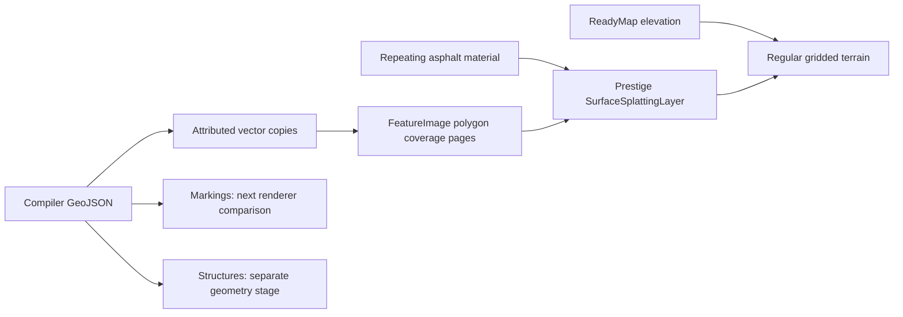

# Prestige asphalt on regular terrain

October 12, 2026. Status: minimal ownership contract and first asphalt renderer implemented.
Appearance and correctness remain the priority. The requested R8 upload change is measured below; broader tuning stays deferred.
This is a Stage 1 prototype, not completion of every rendering gate in the [plan](../../../docs/design/prestige-roads-rendering-plan.md).

Update, October 12: coverage tiles now use linear **R8**, as requested to reduce storage and upload traffic.
The CPU Blend2D rasterizer still uses a temporary RGBA buffer; its alpha bytes are copied unchanged into red
before caching. Separate asphalt/white/yellow material passes remain. Both REX shaders decode red before
parent fallback, parent/child image morphing, and layer opacity, leaving ordinary image layers unchanged.
Coverage keeps linear filtering and mipmaps, with imagery compression disabled for these masks.
Automatic cache configuration includes the encoding; post-cache normalization also accepts legacy RGBA
alpha and grayscale cache images without mutating shared images. Empty tiles and empty fallback images use
zero red coverage. Material textures and the deferred arena migration are independent of this change.

## What the layer does

`osgEarthPrestige::SurfaceSplattingLayer` is a separate osgEarth image layer, configured as
`<prestige:surface_splatting>`. It contributes an image-layer pass to the **existing terrain renderer**.
It does not create another road mesh, raised sheet, replacement terrain, or elevation layer.
Road coverage comes from the compiler's polygons; a repeating material supplies the asphalt detail.
Both are evaluated on the actual regular-grid terrain vertices, including the engine's terrain morphing.

The three scenes use unchanged ReadyMap elevation. Flattening remains independent. Existing bridge,
tunnel, and other non-ground structure vectors remain separate, with unresolved heights still unknown.
This pass renders asphalt only. The compiler's marking and curb polygons are retained for later stages.



The implementation is in [SurfaceSplattingLayer](../../../src/osgEarthPrestige/SurfaceSplattingLayer),
[its C++ implementation](../../../src/osgEarthPrestige/SurfaceSplattingLayer.cpp), and
[its shader](../../../src/osgEarthPrestige/SurfaceSplattingLayer.glsl).
REX's ordinary and GL4 image-layer shaders have a guarded material hook. It runs after coverage/opacity
and parent-image morphing, before the first imagery layer blends with the terrain base color.
That ordering preserves transparent edges and islands. Other image layers do not enable the hook.

Material coordinates use a WGS84 east/north/up frame anchored in each city. Camera translation is cancelled
in doubles, then reduced by whole texture periods before float shader arithmetic. Coordinates come from
the rendered terrain position rather than restarting at tile boundaries. The prototype supports regional
geocentric maps; projected maps fail explicitly. The demo period is one meter.

The material uses the existing PBR loader, channel-layout decoder, and texture preparation facilities.
Missing albedo uses gray; the default asphalt roughness is 0.85; missing normals leave the terrain normal.
A requested texture that cannot be read is an error. Coverage alpha controls placement; material alpha
cannot enlarge or erase the pavement footprint. There is no displacement or parallax.
The implemented normal convention is RGB XYZ tangent normals, +U east / +V north with positive Y.
Two-channel normal assets are not part of the validated input contract.

The current sample is the existing `data/asphalt.jpg`, with no separate normal map. Its 1066-pixel dimensions
exposed an OSG Texture2D upload limitation: non-block-aligned BC textures were silently changed to raw formats.
The layer keeps those raw inputs uncompressed, including one-pixel defaults, and rejects already-compressed
inputs whose base dimensions are not block aligned. Block-aligned inputs use the shared material preparer.
The workaround is local to this layer, since the texture arena uses a different upload path.
See the ordinary upload path in [OSG 3.6.5 Texture.cpp](https://github.com/openscenegraph/OpenSceneGraph/blob/OpenSceneGraph-3.6.5/src/osg/Texture.cpp).

## Minimal ownership contract

`render_contract.py` publishes `render-contract/contract.json`, `ownership-domains.geojson`, and attributed
copies of all five ground material files for each frozen fixture. It reads retained compiler construction
domains from the local `resolved.pkl`; it does not guess source ownership from the nearest road.

| City | Junction owners | Shared network owners | Attributed asphalt polygons | All attributed material polygons |
| --- | ---: | ---: | ---: | ---: |
| Boston | 359 | 1 | 1,079 | 15,174 |
| NYC | 254 | 1 | 744 | 14,048 |
| London | 295 | 1 | 1,046 | 16,963 |

The original fixture files remain byte-identical. Attributed copies split polygons at disjoint compiler
junction domains and the remaining network domain. Across all fifteen material collections, the largest
union symmetric difference is 0.000587 m² after geographic round-tripping. Each feature carries:

* `surface_id`, `receiver_id`, material identity, feature ID, and original parent-feature identity.
* WGS84 2D coordinates and explicitly null vertical profile/elevation.
* A source-evidence reference and a statement that material identity does not establish mapped evidence.

Junction IDs use source node sets; the remainder uses `network/{city}`. Shape IDs identify a particular
revision, not a promise of identity after shape edits. The shared remainder is deliberately not a solved
per-road corridor graph. One-to-one paint provenance remains deferred; existing evidence files stay linked.
The contract references the original structure package, source-node incidence, and resolved lane movements
separately. It adds no connections where roads merely cross in projection.

An optional `prepare_splatting.ps1` creates a disposable GeoPackage spatial index of asphalt, retaining the
same geometry and attributes. GeoJSON remains authoritative. Index hashes must match before the scene generator
selects it; otherwise it uses GeoJSON. This is a runtime convenience, not a new compiler interchange format.

## Run the demos

Use `build.bat` for the runtime. Starting from the three compiled fixtures:

```powershell
python tools/experiments/prestige_roads/render_contract.py boston nyc london
./tools/experiments/prestige_roads/prepare_splatting.ps1
python tools/experiments/prestige_roads/surface_splatting.py boston nyc london
./tools/experiments/prestige_roads/view_splatting.ps1 -City boston -View intersection
./tools/experiments/prestige_roads/view_splatting.ps1 -City nyc -View intersection -GL4
./tools/experiments/prestige_roads/view_splatting.ps1 -City london -View intersection
```

The launch script initializes `osgearth_shell.bat`. Other views are `overview`, `detail`, and `grazing`;
`-TerrainDetail 32` selects the coarser screen-space error setting (default 8).
`-Mode coverage` selects a plain gray FeatureImage comparison. The scene generator retains bounded native
ReadyMap samples solely to place camera targets above ground, converting EGM96 heights to WGS84 ellipsoid
heights with osgEarth's geoid grid. It does not bake or alter the scene's elevation.

Generated scenes and `surface-scenes.json` are under `output/render-fixture-{city}`. Each scene uses
512-pixel coverage, minimum LOD 15, maximum data LOD 19, two-meter feature-query buffer, a 17-node terrain tile, and no
disk coverage cache. The maximum terrain LOD is 22. Launch settings are 1200×1000 requested window size,
four samples and logarithmic depth; captured client images are 803×699 logical pixels on this display.

The minimum uses the existing `min_level` tile-generation and visibility gate. Asphalt and paint share
the initial cutoff; the layer and reusable material may still initialize before roads are visible.
Earlier validation below includes LOD 14 samples from before this cutoff was introduced. Those remain
historical raster evidence. The later [bridge slice](BRIDGE_SLICE.md) validates the runtime gate and paired
LOD 14/15 views: roads are absent at 14 and present at 15. A finished activation fade remains open; no speedup is claimed.

## Checks and saved views

Build/install completed using `build.bat`. Four existing CPU material-preparation test cases passed with
66 assertions. The aggregate GPU/material run exited before a completion summary; it is not reported as green.
All transient audit/test harnesses remain outside the repository.

* Hashes confirm original vectors, lane connections, topology, structure output and source evidence are unchanged.
  All 46,185 attributed material features have unique per-collection IDs and resolving ground-owner references.
* CPU raster checks sampled 48 adjacent coverage tiles at LODs 14, 16, 18 and 19, totaling 12,582,912 pixels.
  At LODs 18/19 there were no interior missing pixels or exterior spill beyond a two-texel boundary band,
  using alpha thresholds 250/5. Coarser levels had 88 slightly reduced interior-alpha samples (minimum 243/255)
  and 76 exterior residual samples. These antialiasing residuals remain recorded, not rounded away as a perfect pass.
* All indexed asphalt geometries match GeoJSON exactly in WGS84. Different drawing order changes 674 of those
  coverage samples by at most one 8-bit channel unit. The indexed and original raster paths are not bit-identical.
* An independent double-reference/float-coordinate calculation tested 60,000 point/camera combinations across
  all three anchors. Maximum periodic coordinate discrepancy was 1.012 mm with a one-meter material period.
  This numerical check does not replace a full moving-camera terrain-morph regression.
* Boston and London intersections were inspected with ordinary REX, and NYC with the GL4 path. Boston detail
  at SSE 32 and a grazing/panned view at SSE 8 show the repeating asphalt. No shader errors were logged.

Evidence is in [surface-splatting-validation](output/surface-splatting-validation/), including:
[Boston intersection](output/surface-splatting-validation/boston-intersection-8.png),
[Boston detail](output/surface-splatting-validation/boston-detail-32.png),
[Boston grazing](output/surface-splatting-validation/boston-grazing-8.png),
[NYC GL4](output/surface-splatting-validation/nyc-intersection-8-gl4.png), and
[London](output/surface-splatting-validation/london-intersection-8.png).

## Next work and limits

Deferred implementation note: return to `MaterialArena` and `TextureArena` for shared splatting materials,
texture residency and bindings. Reassess the ordinary Texture2D upload workaround with that upload path.
The user explicitly deferred this migration; proceed with markings first.

Compare the same marking polygons through nearby mesh decals and fine paint coverage, using these three
fixtures. Keep asphalt in this layer and preserve the separate structure receiver identities. Existing
flattening and later bridge-height/profile work remain separate.

Before declaring all Stage 1 correctness gates complete, add normal-map convention and shadow/depth/picking
regressions, and a repeatable moving-camera run through forced terrain LOD changes. Current visuals exercise
normal camera motion and two terrain settings, not that exhaustive run. The sample material is visibly
repetitive and lacks a dedicated roughness/normal asset set; material art can improve independently.
Broader performance comparisons, residency measurements, and tuning remain deferred. The R8 upload measurement below
is limited to this explicitly requested format change.


## R8 coverage validation and upload measurement

October 12, 2026. Built and installed with `build.bat` (public library version 192). All existing
surface-splatting configurations select R8 automatically; no earth-file conversion is needed.
This changes coverage encoding only. The three asphalt/white/yellow passes, material assets, source vectors,
terrain grading, and deferred material-arena work retain their existing design.

Coverage is produced by `FeatureImageLayer` / `FeatureRasterizer`, using **Blend2D on the CPU** in this build.
Its temporary RGBA raster buffer retains the established polygon and antialiasing behavior. The splatting
layer copies alpha to red before caching; finished images are `GL_RED / GL_UNSIGNED_BYTE / GL_R8`.
A direct one-channel rasterizer remains a possible later change; scratch-buffer allocation is not reduced here.
The standard cache uses serialized images, not JPEG or an alpha-only PNG convention.

Validation used transient harnesses outside the repository:

* 64 native tiles across Boston, NYC, and London, at levels 15/18/19/21, with adjacent tile requests:
  every finished R8 byte equals the old rasterizer alpha byte. This exercises 122,495 fractional edge samples.
  London has no yellow material features and is excluded from that material test only.
* All seven generated mip levels (512 down to 8 pixels) have identical reference alpha and R8 coverage.
  Actual GPU readback is byte-exact for R8 in ordinary REX and NVGL, with driver storage confirmed as R8.
* 208 cache/format checks include fresh persistent R8 generation, cache-only reload, old RGBA cache-only
  conversion, padded rows, image origin, grayscale input, cancellation, and no mutation of shared source images.
* Empty generated tiles and fallback images contain zero coverage. 1,296 production-fragment shader scenarios
  compare R8 with alpha for empty/full/fractional children and parents, missing parents, enabled/disabled morphing,
  layer opacity, and first/subsequent layer blending in both renderers. Results agree within 1e-6.
  A negative control that decodes coverage after parent fallback fails, confirming the LOD fade test detects that bug.
* The ordinary NYC junction and the combined NVGL NYC scene were inspected after rebuilding. Crosswalks, turn arrows,
  and white/yellow lines remain visible. The combined scene retains buildings, vegetation, sky, and graded roads.
  No shader errors were logged. These checks are not a claim that every unrelated unit test was run.

A 512-square base tile is now **262,144 bytes**, down from **1,048,576 bytes**. With the factory's seven mip levels,
its host upload payload is **349,504 bytes**, down from **1,398,016 bytes**: a 75% reduction in both cases.

Google Benchmark measured completed NVGL upload batches on the local NVIDIA RTX 5080 / driver 610.60.
Each batch uploads sixteen freshly allocated textures with precomputed production mipmaps; allocation/upload and
GPU completion are timed, while vector rasterization, mip construction, texture-wrapper creation, and release are excluded.
There are 100 batches per repetition and five repetitions. Values below are median batch wall times;
raw logs retain every repetition, including the slower first R8 repetition.

| Upload path | Median per 16 tiles | Repetition range |
|---|---:|---:|
| Previous RGBA input, NVGL default GPU BC3 compression | 33.8 ms | 33.4-37.0 ms |
| R8 input, R8 GPU storage | 0.507 ms | 0.503-1.35 ms |
| Uncompressed RGBA control | 1.63 ms | 1.61-1.66 ms |

The old NVGL uploader automatically compressed RGBA into BC3 even when the layer requested no compression;
R8 avoids that existing RGB/RGBA compression branch. Removing driver compression accounts for much of the
large baseline timing difference. The uncompressed control isolates a smaller, roughly 3.2x median improvement.
This is an upload microbenchmark, not a frame-rate or end-to-end tile-generation speedup claim.

GPU storage needs a separate qualification: ordinary RGBA8 storage becomes one quarter the size, but the old
NVGL path already stored BC3 at one byte per pixel. Therefore this is **not** a fourfold NVGL VRAM reduction.
The old BC3 marking fixture also had up to 25/255 alpha readback error; R8 preserves the original bytes exactly.

Saved evidence: [tile/mip/GPU checks](output/r8-coverage-validation/results.log),
[cache checks](output/r8-coverage-validation/cache-results.log),
[shader checks](output/r8-coverage-validation/shader-results.log),
[negative control](output/r8-coverage-validation/shader-negative.log), and
[isolated benchmark](output/r8-coverage-validation/benchmark-results.log).
